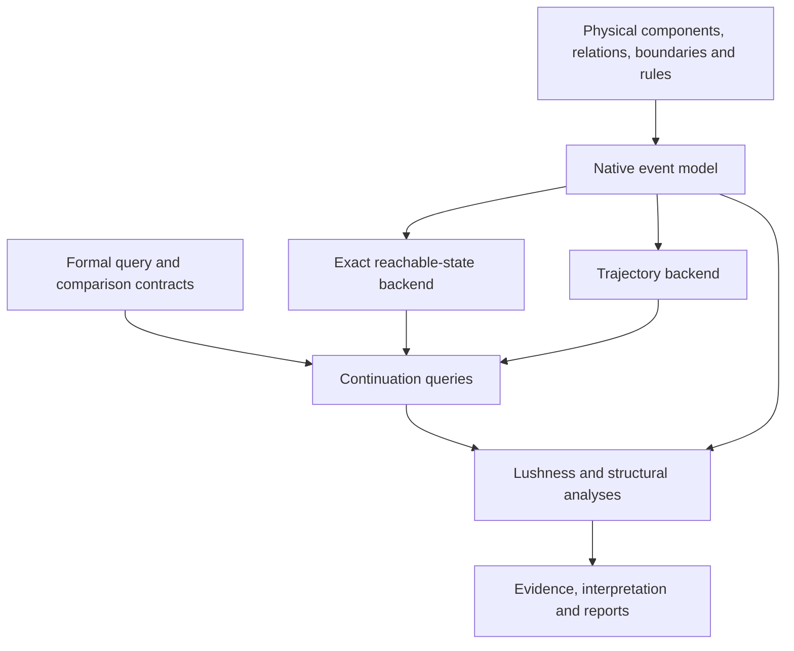

# Omega experimental platform: vision and architecture

> Repository adaptation, 24 October 2026: selected for the v4.1-based `omega-cosmology` preparation. Package paths and imported-reference links are adapted; the unchanged source is in `archive/legacy-testbed/`. Design readiness does not claim engine implementation.

Revision 3 — 24 October 2026

For review by Paolo, Opus and Sol; intended implementation lead: Sol 6.1.

**Status: design proposal.** The user authorized writing this specification and
is willing to repeat experiments on the new substrate. No implementation, run,
commit, push, manuscript edit or external distribution is performed or authorized
by this document alone. Opus's review is advisory; decisions remain with Paolo.

This proposes a new generation of the test bed alongside the existing one. It
is intended to serve the programme beyond v4.1. It incorporates the formal
commitments established in the conversation and local project context; it does
not claim a fresh line-by-line review of the latest formal drafts on Drive.

Revision 3 incorporates Sol's supplied architectural review: spatial relation
contracts, explicit baseline families, contextual compression and boundary
experiments, deterministic/response conformance cases, controller information
limits, and a hard M0 grammar test. See section 21 for disposition and scope.
M0–M2 remains the immediate engineering target; R4 and boundary expansion are
roadmap items. This proposal does not itself launch implementation.

Revision 2 incorporated Opus's supplied review against Appendix A r20,
foundations r4 and the drafted chapters, with the qualifications recorded in
section 20. Appendix A r20 was not found in the inspected local attachments;
its result IDs below originated in the review. A subsequent read-only Drive
check verified the applicable r19 definitions and foundations r4; r20 was not
found by exact-name or broader metadata search. See
[source verification](FORMAL_SOURCE_CHECK_r1.md) for verified mappings and the
remaining r20 delta. Do not claim r20 conformance from the r19 check.
The first revision remains available as the original proposal.
Revision 2 remains the Opus-reviewed stage of the design.

## 1. Vision: the object we want to investigate

The intended object is a physical continuation field: from a sufficiently
specified present, the native law supports weighted histories whose components
can alter the conditions for further development. Organization, access,
constraints, noise and selection are parts of that law.

The programme asks how physical arrangements change that continuation, how
enabling structures can construct further enabling structures. The platform
computes lushness rankings; researchers assess their correspondence with ethical
judgments and investigate the physical cause of agreements or conflicts.
It does not begin with a chosen agent's catalogue of externally valued goals.

The platform should support worlds in which:

1. Material configurations create or remove physical pathways.
2. Those pathways change access to resources, other configurations and control.
3. Resource use pays for maintenance, repair, construction or destruction.
4. Compositions acquire consequential functions through their relations.
5. Several organizations can cooperate, compete, appropriate, substitute for or
   reconstruct one another.
6. Controllers, when present, are physical structures inside these worlds.
7. We can evaluate the resulting weighted continuation without rewarding any of
   those descriptions by name.

The long-term target is an ecology of organizations that build, constrain and
rebuild one another. A bounded exact world is the first executable instance,
not the definition of the entire object.

### What success would look like

A researcher can introduce a costed storage component, a transport interface,
a new assembly, a population variant or a damage mechanism by declaring its
physical states and rules. Existing thermodynamic, continuation, access and
recovery queries then work where their stated assumptions hold. Unsupported
questions are reported explicitly.

A fourth experiment should mostly require new physical rules and query
configuration, rather than another compiler, entropy routine and report system.
Adding a genuinely new kind of physics may require a new adapter. Extensibility
does not mean every conceivable process fits a single reaction simulator.

### Scientific position

There may be regimes where costed recursive access compounds enough to exceed
a matched baseline, and regimes where it does not. We seek the relationships,
boundaries and mechanisms. A missed guessed threshold is not a theory failure.
An unfavorable result is not automatically dismissed as a missing feature.

Stored work, organization, persistence, information and population are physical
readouts. None is silently substituted for lushness. Lushness measures the
effective breadth of the declared continuation law; its correspondence with
possible value and ethical judgments remains the programme's substantive thesis.

## 2. Why a new generation is justified

The current system has earned assets: reversible physical mechanisms, numerical
audits, exact sampled-history calculations, local-history bounds, source-frozen
execution, capped workers, replay and evidence retention. These should survive.

The current ecology nevertheless enumerates two pools and three apparatus types
explicitly. Its base WorldSpec expects an enumerated tuple of states. Some
analysis depends on ecology-specific model objects. Several scientific questions
have acquired dedicated runners and reporting paths. Extending this pattern
would make each new feature another special case.

That is a design limitation, not a repudiation of earlier results. The user is
willing to rerun studies so the architecture can be chosen for the intended
object rather than backward compatibility with every old generator.

The new system should retain old experiments unchanged as reference evidence.
Port selected calculations for regression, then rebuild selected scientific
experiments on the new physics. Exact reproduction and conceptual replication
must be reported as different achievements.

The available-work audit remains valuable. Its contracts become a first-class
analysis package in this platform rather than another permanent scenario-specific
extension. A cheap reanalysis of old evidence can proceed independently when
authorized, but is not a prerequisite for designing the new physical core.

## 3. Design decisions and their justification

| Decision | Reason | Consequence |
|---|---|---|
| Separate formal queries, physical laws, backends and interpretation | Each carries different assumptions | A simulator choice cannot silently redefine lushness |
| Local rules over components and relations | Composition must change future access | New assemblies can acquire functions without a new simulator |
| One native event interface for exact and sampled execution | Prevent dynamics drifting between modes | Differences in outputs are estimator/backend issues that can be tested |
| Explicit boundaries and endowment | Equal energy alone is insufficient matching | Resource and environment assumptions accompany every comparison |
| Physical controllers, external evaluators | Preserve embodiment while testing the objective | No free sensor, action entropy or hypothetical policy-switch branch |
| Exact small worlds as reference instruments | Larger worlds lose exhaustive calculability | Sampling estimators are calibrated against known instances |
| Explicit symmetry and observation contracts | Labels and projections can change entropy claims | Population aggregation must be justified, not merely convenient |
| Analysis-only structural monitors | Witnesses must not inflate the physical state score | Generations, ownership annotations and event tags remain diagnostic |
| Progressive architecture with runnable slices | Avoid a universal engine that never produces science | Each stage has physical and numerical acceptance criteria |

The implementation must not require quantum physics, an ML library, a theorem
prover or a distributed cluster in its first release. Interfaces should leave
room for them where meaningful, without pretending support exists.

## 4. Layering and dependency direction

Queries may request computation but cannot alter the physical law. Physical
interventions create a new versioned world or an explicit transition procedure.
Reports cannot add or remove events from the measure. Numerical caps cannot
silently become physical boundaries.

Recommended separate package: `src/omega_cosmology/testbed/` with subpackages
`semantics`, `physics`, `backends`, `queries`, `analysis`, `studies`, `workflow`
and `reference_cases`. This name is provisional; avoiding coupling to the old
scenario modules matters more than the spelling.

Old pure numerical helpers may be imported behind narrow wrappers after their
assumptions are checked. Do not copy entire scenario runners into the new core.
No deletion or reorganization of historical evidence is required.

## 5. Formal semantics: the stable scientific interface

### 5.1 Core records

Use six versioned public records with stable semantic identifiers. Nested
fields retain the distinct meanings below; consolidation reduces duplication,
not the information required to interpret a result:

| Record | Required meaning |
|---|---|
| PresentSpec | Section, sufficiency, exact/distributed/record conditioning, and provenance of that conditioning |
| LawSpec | State representation, native dynamics, boundaries, conserved quantities and physical implementation |
| ObservationSpec | History map plus distinct scope, conditioning reference and resolution subrecords; retained distinctions and memory |
| ComparisonSpec | Comparison kind, shared assumptions/endowment, physical realization, and continuation window/orientation/schedule |
| QuantitySpec | Exact mathematical quantity, units and interpretation |
| EvidenceSpec | Method, assumptions, numerical uncertainty, provenance and applicability |

Queries of one arm use ComparisonSpec's continuation subrecord without requiring
a fictitious second arm. Store shared metadata once with explicit references;
validate that observation and quantity conditioning agree. Scope selects which
histories are queried; the observation map and conditioning determine what is
known about them. Sharing a public record does not make these interchangeable.

A frame specifies an admissible present section; it is not synonymous with a
compartment, organism or tuple projection. The first classical adapter supports
one synchronous state section and declared record conditioning. Arbitrary
causal cuts are a future adapter capability, not claimed by providing a field
called `orientation`.

For the first classical backend, admissibility requires a sufficient declared
full state: the implemented law fixes the conditional future given that state
and any explicitly declared external schedule. Include physical memory,
resource dependencies and hidden control variables that affect transitions.
An autonomous homogeneous CTMC therefore uses a Markov full state. A later
time-dependent law must declare its schedule/time parameter or its physical
clock; the condition is sufficiency, not universal stationarity.

A projected observer can have incomplete records and a non-Markov history law
while the underlying physical present remains sufficient. A finite collection
of empirical Markov tests cannot prove sufficiency of a real-world description.
Record the construction argument, dependency audit and scope of the assertion.

Time T is an adapter parameter along the chosen continuation orientation. Its
use in CTMC computation does not make time primitive in the general ontology.

### 5.2 Primary continuation quantity

For the initial finite classical backend, root x, delta>0 and T=n delta:

    ell_x(T,delta) = H(X_delta, ..., X_n_delta | X_0=x)
    L_x(T,delta)   = 2^ell_x(T,delta).

Store ell in bits and avoid exponentiation overflow. For the full Markov state:

    P_delta = exp(Q delta)
    ell_x = sum_k mu_k dot H(P_delta rows).

This is numerically calculated full sampled-history entropy for the declared
state, not an analytic certificate for every physical resolution. Continuous
trajectory densities and event-timing differential entropy are separate queries.

For a preparation distribution, distinguish average root-conditioned entropy
from entropy of a mixture whose root is unobserved. They differ and must have
different quantity IDs. No automatic root-draw entropy bonus.

For a projected history Y=f(X), expose two different quantity IDs:

    part_history_given_full_present: H(Y_1,...,Y_n | X_0=x)
    part_history_given_own_present:  H(Y_1,...,Y_n | Y_0=y).

The second requires a declared compatible law over hidden initial states given
y. It cannot be recovered from one exact root alone without that additional
conditioning information. Never silently choose a uniform or equilibrium prior.
Conditional entropy inequalities hold after the appropriate averaging; they do
not impose a pointwise ordering at every specified present. Store precisely
which conditional distribution and scope each query uses.

Compute or bound these history entropies using the underlying physical model.
Do not substitute a one-step marginal entropy or assume Y is Markov. Dynamic
membership, such as an assembly gaining/losing components, requires an explicit
history observation rule and treatment of birth, dissolution and shared parts.

The continuation profile is the primary object of comparison. Rates and offsets
are its long-horizon description where they exist. If two profiles satisfy
ell_a(T)=h_a T+b_a+o(1), a strict rate difference determines their eventual
ordering; equal rates require examining offsets or further terms. State the
scope and assumptions when requesting that asymptotic comparison, and never
substitute it for a specified finite window or subtract infinity from infinity.
Nonconvergent profiles may have no such ordering. Expected jump counts and
temporal crossover profiles remain explanatory diagnostics. The reviewer maps
the asymptotic reading to A.3.9, pending direct source verification.

### 5.3 Scope, resolution and options

Use the literal scope label `whole_modeled_field` in exported quantities and
report headings. Implicit baths and sources have ledgers
but unresolved histories. Matched boundary prescriptions do not establish
cancellation of omitted environmental entropy. Record that scope limitation.

A proposed encompassing-field inference additionally declares and supports the
reviewer's A.7.11 premises: E1 unchanged exterior marginal law under the options,
E2 finite affected entropy, and E3 the applicable exhaustion/convergence
condition. Checked against r19: E3 requires finite-entropy exterior descriptions,
nested as functions of the next, which together determine the same exterior
at the declared resolution. Recheck any r20 changes. An unchanged
exterior does not mean unchanged correlations: retain the mutual-information
correction when applying such an extension. The default is no encompassing-field
claim, not automatic certification from matched source settings.

Relabelling must preserve results. A physically distinguishable refinement can
change them. A coarse observational projection and a faithful physical quotient
are different objects. The programme's finest-faithful-description commitment
does not certify this adapter as the finest description of nature.

Every ranking has resolution evidence matching r19 A.6.5/A.6.6, with separate
fields rather than one exclusive enum:

- `certification`: the named refinement(s), bounds and sign margin showing that
  the ranking survives them. Physical faithfulness is not a premise of that
  mathematical certificate. It covers no further refinement by implication.
- `faithfulness`: established/open for each refinement, with physical argument.
- `reversal`: none, corrected by a refinement shown faithful, or resolution-
  dependent when a reversing refinement's faithfulness remains open.
- `governing_status`: provisional unless the claimed governing comparison is
  actually justified. A ranking can be certified against one refinement and
  remain provisional against others.

A numerical pass or three agreeing cadences supplies no refinement certificate.
Report unresolved numerical signs separately. Preserve both sides of a reversal
and the conditional-entropy contribution carrying it. Default faithfulness is
open and governing status provisional. Verify any changes in r20 before claiming
that revision's conformance.

ComparisonSpec contains a field-by-field admissibility checklist, using the
reviewer's A.7.12 mapping and verified foundations r4 section 7: common present
when claiming options; continuation
laws rather than selected outcomes; matched resolution; options physically
carried out rather than postselected; stated horizon/restriction; and the
required invariance argument with proved/unproved/unsupported status.
An option's implementation costs and initial hardware belong in that checklist.
Classify the scientific contrast as preparation, process or mechanism (reviewer
mapping A.3.6). Only a physically realized process contrast supports a choice
from one present. A preparation can become the result of a preparation process,
but that process must itself be modeled before making the choice claim.

Distinguish a fixed controller implementation, a policy chosen offline and a
physically programmable controller. Alternative policies become branches in
one law only when reachable hardware states/transitions implement the changes.
Do not add entropy for an external evaluator's catalogue of policies.

## 6. Physical substrate: local composition under fixed laws

### 6.1 State representation

Adopt a bounded typed relational state as the first substrate. A state consists
of material components, finite internal variables, resource quantities,
locations and typed connections between ports. Examples of connections are
bonds, transport contacts and signal interfaces. None has moral meaning.

The first exact worlds use a finite material inventory and a small set of
physical locations. Assembly changes bonds, component states and accessible
interfaces. Population growth constructs additional functional assemblies from
latent material; it does not create matter by incrementing a population label.

The implementation may encode states as compact integer tuples/arrays. A public
state API supplies canonical identity, local neighborhoods and rule matching.
Analysis must not rely on tuple offsets or names such as A/B/C and left/right.

Supply finite-domain count coordinates for genuinely interchangeable pools and
relational component coordinates where arrangement matters. Avoid forcing every
particle into an explicit object when counts are sufficient, or compressing a
functional arrangement into counts when they are insufficient.

### 6.2 Component and relation definitions

Each component type declares:

- material inventory/stoichiometry and internal states;
- energetic contribution, including interaction dependencies;
- ports, permitted bonds and location constraints;
- resource storage domains, units and capacity;
- intrinsic state degeneracy/reference measure;
- transition and interaction rule participation.

Relations can contribute interaction energy. The global energy evaluator must
include these contributions; changes in a bond cannot bypass the energy bills
of reactions that depend on it. Degeneracy and energy belong to physical
definitions, not to the reporting layer.

Each spatial/operational relation additionally declares:

- physical support: endpoints, occupied sites/ports and any intervening carrier
  or material; metric length where the chosen geometry defines it;
- transport/signalling dynamics and latency, including whether transit is
  represented explicitly or eliminated through a declared effective model;
- construction/dissolution work, material and interaction-energy changes;
- capacity, contention and arbitration rules at shared interfaces;
- maintenance, damage and repair paths, where those processes are modeled.

No universal positive cost per edge or distance is imposed. A geometry-free
well-mixed relation must be labelled as that idealization. Equal graph topology
or edge count does not establish equal physical budgets or response times.
All geometry-dependent rate/cost functions are part of LawSpec and the matching
contract, not informal interpretation after a run.

For the initial Markov backend, communication/transport delays use physical
in-transit states, local hops or a declared memoryless effective rate. A fixed
delay cannot be implemented as an invisible scheduled callback while claiming
the visible state remains Markov. A phase-type delay approximation records its
additional stages and changed physical/observational resolution. Numerical
timesteps and simulation wall-clock latency are never physical costs.

Finite capacity must represent a physical inventory or boundary. An enumeration
limit represents a computational cap and must return an incomplete status.
Never convert the latter into a reflecting wall or silent state deletion.

### 6.3 Rules and shared native event interface

A rule declares a local pattern, applicable conditions, a state transformation,
material stoichiometry, physical support, energetic changes, reservoir exchanges
and a rate law. Its event instances expose:

    target state, propensity, physical support, mechanism identity,
    reverse-pair identity when applicable, resource/work/heat increments.

Rules use a declarative pattern/transform vocabulary and a small registry of
reviewed rate functions. Arbitrary per-experiment Python callbacks are an escape
hatch with provenance and additional validation, not the default modeling API.

Exact enumeration and trajectory simulation consume the same event instances.
For sampled execution, dependency indexing may update only affected local
matches, but must reproduce full enumeration on small worlds.

Multiple mechanisms reaching the same physical target sum in Q for state-history
entropy. Keep them separate in thermodynamic flux accounting when work/affinities
differ. Unchanged-state proposal events and duplicate rule labels add no physical
history entropy. A failed attempt counts only through its actual physical changes.

### 6.4 Thermodynamic contract

The initial physical adapter uses one thermal bath, declared inverse temperature,
finite energy units with exact rational bills, and reversible elementary pairs.
Fractional costs are supported without randomized rounding.

For an elementary reversible pair, require a local detailed-balance relation
consistent with state energy, degeneracy and external work. One supported form:

    log(k_ij/k_ji) = log(g_j/g_i) + beta[W_ij − (E_j−E_i)].

Symmetric catalytic assistance changes kinetics without changing this ratio.
The assistance multiplier must be well defined for the pair, not independently
read from endpoints in a way that changes equilibrium inadvertently.

Not every later module must be an equilibrium model. Explicit driven or
irreversible idealizations declare their source/sink, assumptions and loss of
equilibrium guarantees. They cannot bypass accounting by being called damage.

Boundary records identify work sources, thermal baths, material reservoirs and
their budgets, lifetimes and feedback. A maintained source is not a finite fuel
stock. Finite-source depletion and replenishment are physical modules.

### 6.5 Composition and emergent function

A compound's function must follow from its arrangement. For example, a bound
capture component connected to a transducer and storage element can enable paid
construction; separated constituents cannot execute that composite route under
the same local interaction rule.

Rules may recognize a small local motif that exposes a new interface. A motif
is a declared physical hypothesis, not unexplained emergence. The same rule must
apply wherever that motif forms, including in disordered reference preparations.

Every enabling motif needs an auditable formation path: material, bond energies,
barriers, work, dissipation and any upkeep. Initial motifs appear in the matched
preparation/endowment ledger. Merely recognizing an existing physical interface
must not charge a second arbitrary capability fee. Spontaneous favorable assembly
is allowed when the physical rates/accounting permit it. The requirement is
complete physical accounting, not a universally positive extra work bill.
Conformance tests construct the same motif through different permitted histories
and in different locations; its interface and local rule must be the same when
the relevant physical surroundings agree. No favored seed gets an exclusive rule.

Higher-level compound recognition is normally a derived analysis. If a macrostate
changes dynamics, its internal structure must either remain represented or be
replaced by a validated effective model. Never score both an assembly and an
extra independent copy of its constituents' entropy.

## 7. Identity, symmetry and aggregation

This is foundational for population and composition, not a later optimization.

Separate computational identifiers, physical records of identity and fixed
physical site labels. Swapping two identical unmarked components can be pure
bookkeeping; swapping their positions or records can change physical relations.

Start with a small labelled reference backend and an explicitly declared
unlabelled/canonical representation where appropriate. Validate graph/state
canonicalization, event multiplicities and equilibrium degeneracy together.
Do not assume orbit size is automatically the correct physical degeneracy.

For R0-R1 use count coordinates plus a small fixed set of relational slots,
explicit finite symmetries and a labelled reference. General graph
canonicalization can wait until R2 needs it. The relation API and arrangement-
dependent functionality remain requirements from R1; postponing a graph library
must not reduce the substrate to unrelated count variables.

Degeneracy enters physical rate ratios and thermodynamic entropy. It is not an
extra term in sampled-history lushness unless those microscopic distinctions
are explicitly resolved histories. Test an unresolved degenerate state without
transitions: its conditional history entropy is zero, regardless of log g.
Changing degeneracy can still alter rates and thus the resolved history law.

For an exact quotient, require symmetry/lumpability conditions sufficient to
preserve the declared observed law. Preserve multiplicities in transition
rates. If those conditions fail, retain the finer dynamics and treat aggregation
as a non-Markov observation query with appropriate estimation or bounds.

Mandatory two-copy tests distinguish:

- arbitrary IDs producing spurious extra entropy;
- distinct physical placements or records legitimately creating new histories;
- identical components supporting different joint compositions;
- dynamic bonds invalidating a count-only aggregation.

Include pure relabellings at intermediate times, not just the root. A trajectory
of identity permutations of unmarked components contributes zero physical
history entropy at the declared quotient. Genuine movement, bond rearrangement
or recorded identity is not removed merely because components share a type.

Homogeneous populations can later use count compression. Heterogeneity,
history-dependent identity and spatial structure may require more resolution.
Do not promise that all population expansion will remain computationally cheap.

## 8. Control and agency

Sensing, memory, actuation, communication and reprogramming are physical rule
modules. Their registers, locations, bills, delays and damage susceptibility
belong to the world. Their stochastic activity counts like other physical activity.

An ideal direct-state controller can exist as a labelled benchmark. It is not
reported as an embodied agent. The default scientific layer knows the stipulated
model and compares physically instantiated candidates; it does not know which
stochastic future occurs.

Begin with small stationary finite-state controller families, then support:

1. Independently controlled interacting organizations.
2. Perfect-observation receding-horizon control as a distinct experiment.
3. Partial observation, uncertainty and model mismatch.
4. Learned controllers through the same physical observation/action interface.

The physical response is executed by native events, not by editing the state
for free after an external action call. A later ML wrapper exposes legal paid
actions and observation channels. Training compute and physical deployment cost
are distinct scopes and must be stated.

Controller traces preserve the actual observation channel, physical memory,
legal actions, execution state and any represented belief/model estimate. Log
estimated outcomes separately from oracle evaluations and realized outcomes.
Where available, retain reversibility/recovery measures and the physical
influence channels open to affected systems. These are readouts, not extra
rewards or a consent score.

A whole-modeled-field ranking is evidence about stipulated continuations. It
does not by itself establish that a situated controller knows that ranking,
can implement the selected continuation, or is justified in imposing it under
the programme's bounded-agent account. Test those claims separately against
information, implementation, uncertainty and correction channels. Do not turn
this distinction into an unmodeled moral veto on the oracle objective or an
extra permission gate in ordinary experimental execution. GE's normative
justification remains outside the simulator's automatic numerical verdicts.

Every controller family declares its null options physically. Distinguish no
command events, commands targeting idle, a selector fixed in a mode, autonomous
native relaxation and a sham selector with no productive coupling. Specify which
is realizable under the same law and which is a mechanism ablation. Never use
the word idle alone as the comparison identity. Null-control reports include
actual switching, refunds, stored selector energy and downstream occupation.

No action is intrinsically labelled cooperation, exploitation or protection in
the generator. Those descriptions follow from direction of flows, altered access
and consequences for declared scopes. Whole and local objectives use the same
quantity definition with different history projections; local bounds must be
tight enough before claiming a resolved conflict or optimum.

Exclusion must be implemented through physical occupation of a site/port,
possession of a resource or an explicitly costed barrier/gate. An actor's command
may not simply delete another actor's events without a mediating physical state
and its dynamics. That mediator can itself be damaged, released or transformed
as supported by the law.

## 9. Backends and numerical guarantees

### Exact reference backend

Enumerate reachable states on demand from the declared root/support using the
native event interface. Keep a separate capability to cover multiple roots and
communicating classes. Store sparse Q and the physical mechanism ledger.

Enumeration stops with explicit frontier diagnostics if its cap is exceeded.
No probability threshold may remove native possibilities while the result is
called exact. Approximate truncation requires its own error contract.

Reuse streamed sampled-row calculations, continuous occupation rewards,
reducible-chain analysis and immutable query chunks after conformance testing.
Avoid dense full transition matrices except small validation examples.

### Trajectory backend

Use the same event law for CTMC trajectories. Validate event frequencies, state
distributions and resource balances against exact small worlds. Reproducible
seeds and independent streams are recorded. Analysis monitors do not affect rates.

Simulation alone does not yield reliable high-dimensional history entropy.
Provide an estimator registry with quantity, assumptions, finite-sample error,
bias limitations and supported observation structures. A CTMC event likelihood
is not automatically the likelihood of a discretely sampled history with hidden
intermediate events.

In the first release, retain this result contract but defer a generic estimator
plugin registry. Exact methods and a small sampler conformance harness suffice
for R0-R1. Implement a registry once there are distinct real estimators needing
dispatch. Do not defer uncertainty and quantity metadata with the registry.

Local-history filters, conditional estimators and entropy bounds can be added
progressively. Importance sampling or rare-event methods must retain weights
and uncertainty. If a key comparison remains unresolved, say so.

### Result guarantees

Every numerical field carries one of: analytic value, numerical full-model
calculation, rigorous bound under stated assumptions, statistical estimate with
uncertainty, heuristic diagnostic, or unsupported. Float residual checks are
not interval-arithmetic proofs. A confidence interval does not bound estimator
bias unless the method establishes that.

## 10. Analysis packages and the formal arm

Analyses declare capabilities rather than adapter names. Initial packages:

| Package | Outputs and limits |
|---|---|
| Continuation breadth | Full sampled-history profiles, projected histories/bounds, rates and offsets |
| Temporal profile | Expected jumps, finite fine-cadence coefficient, verified crossover diagnostics |
| Thermodynamics | Degeneracy-aware free energy, work/heat balances, entropy production and reference scope |
| Access | Enabled paths, competing resource uses, bottleneck occupancy and pathway fates |
| Generativity | Mechanistic dependency chains and conservative genealogical witnesses where observable |
| Persistence/recovery | Uptime, interruptions, unconditional recovery, graph-derived closure |
| Contraction/foreclosure | Separate magnitude reduction from loss of specified continuation access; definition and support semantics explicitly versioned |
| Composition/plurality | Functional complementarity, redundancy, substitution and concentration |
| Control/scope | Policy comparisons, material transfers, local/whole rankings and unresolved optima |

The available-work specification supplies the thermodynamic and access details.
Its single-bath KL/beta expression is an availability benchmark, not a new
factor in lushness. Marginal free energies require correlation accounting.
Channel-resolved dissipation requires retaining parallel physical mechanisms.

Structural analyses explain what changes in Omega. They do not repair an
unfavorable scalar result by subtracting noise, adding a welfare reward or
renaming a functional regime non-generative.

Implement foreclosure as its own query rather than a synonym for lower entropy,
stock loss or a finite deadline miss. Verified r19 A.9.3 defines, on one common
labelled resolved-history alphabet and at a specified scope/horizon:

    Theta_n^D(a:b) = supp(P_b^D) minus supp(P_a^D)
    weight         = P_b^D(Theta_n^D(a:b)).

Endpoint reachability is insufficient: two laws can reach the same endpoint
states with different allowed history words. Begin with exact small history
enumeration and cross-check full-state dynamic programming; projected-history
support may require sets of compatible hidden states. Report unsupported queries
when that computation is too large, even if the native state space is finite.

Derive structural positivity from the native graph/law, not a numeric probability
cutoff. For a finite irreducible CTMC sampled at positive cadence, every entry
of exp(Q delta) is positive, so common full-state history support can imply zero
exact foreclosure despite substantial contraction. Include this as a reference
case. Do not substitute a low-probability threshold and retain the exact label.
Sampled trajectories cannot certify impossibility from an event's nonappearance.
Contraction, closure, irreversibility and foreclosure retain distinct quantity
IDs and assumptions. The proposed r20 version still needs comparison with r19.

### Formal reference suite

Create compact cases linking stable semantic IDs to manuscript definitions and
propositions. Chapter numbers are metadata that can change during the rewrite.
For each case include premises, construction, expected mathematical relation,
an independent calculation, numerical tolerance and a premise-removal example.

Required cases:

1. Conditional history entropy and chain rule.
2. Average root-conditioned score versus unobserved-root mixture.
3. Same-law irreducible preparation offsets and reducible class-dependent rates.
4. Projection-induced memory and valid versus invalid Markov lumping.
5. Bookkeeping relabelling versus physical state refinement.
6. Embodied policy flexibility versus an external list of unrealized policies.
7. Equal scalar breadth with different reconstruction structure.
8. Physical composition with non-additive joint continuation.
9. Fine-cadence activity divergence and finite-cadence crossover verification.
10. Matched boundary settings with different realized external work.

Add four cases from the review:

11. An unchanged exterior marginal with changed correlations: cancellation of
    its marginal entropy leaves a nonzero mutual-information correction.
12. Largest contraction and the relationships between contraction and
    foreclosure under the formal definitions, including each non-implication
    where a valid counterexample exists. Do not manufacture one if the verified
    theorem forbids it under the selected premises.
13. A paid register with no action coupling, retaining its physical activity.
14. A local/whole comparison changed by dependence alone while the relevant
    marginal laws are matched, with the whole joint law explicitly realizable.

Add two small M2 reference cases from Sol's review:

15. Nontrivial deterministic evolution from an exact present: state changes
    occur but ell=0 and L=1 at every sampled horizon. Use a finite deterministic
    transition map, not a CTMC with random holding times called deterministic.
    A frozen CTMC is a separate degenerate example. No new general backend is
    required for this small algebraic conformance fixture.
16. Equal history entropy with different responses to the same accessible
    physical interaction, including a case where the coupled whole-history
    entropy remains equal. Mechanistic response difference does not by itself
    imply a scalar difference. A formal deterministic fixture can demonstrate
    the basic identity; a stochastic equal-row-entropy fixture should prevent
    conflating this solely with zero breadth. Physics/energy claims require an
    actual physical realization beyond the algebraic example.

Formal mapping checked against available r19 headings and relevant definitions;
verify the r20 delta before certifying r20 conformance and include source identity
in the suite. The boundary row is corrected below:

| Case | Proposed source |
|---|---|
| 1 chain rule | A.2.1 |
| 2 mixture versus average | A.5.2 |
| 3 offsets/contrast kinds | A.3.5, A.3.6 |
| 4 projection memory | A.7.1, A.7.3 |
| 5 relabelling/refinement | A.1.2, A.6.2 |
| 6 embodied policies | A.2.5 |
| 7 equal breadth/different structure | Chapter 5 section 5.6; assign a stable semantic ID |
| 8 joint continuation | A.7.2 |
| 9 fine cadence | A.6.4; refinement certification A.6.5, A.6.6 |
| 10 boundary matching | Foundations r4 section 7; A.7.10/A.7.11 for exterior cancellation. A.11.1/A.11.2 concern same-law preparations and merging transients, not general boundary accounting |
| 11 correlated exterior | A.7.10 scope, A.7.11, verification V45 |
| 12 contraction/foreclosure | A.9.3, A.9.4 |
| 13 non-acting register | A.8.2 |
| 14 correlation and scope | A.7.6 |

Passing examples supports implementation conformance and illustrates claims; it
does not prove a theorem. Proofs, numerical examples, empirical relationships
and normative interpretations must have separate evidence types.

Quantum records, general causal sections, infinite-volume limits and cosmological
claims remain outside the initial backend. They may share query semantics where
mathematically justified; they must not be presented as validated by CTMC tests.
In particular, incompatible quantum record families need not admit one common
classical probability distribution. A single classical history law cannot
validate arbitrary comparisons across those families.

## 11. First experimental release

Build three connected scientific slices using the same physical grammar.
Choose state counts from actual profiling; the designs below specify mechanisms,
not permission to remove scientifically essential parts to fit a cap.

### R0: semantic and physical calibration

Use tiny reversible switches, binding pairs and a driven capture/storage motif.
Validate symmetry, multiplicities, local detailed balance, source-off equilibrium,
work/heat and exact-versus-sampled execution. Include one inert but physically
fluctuating reference. Establish the cost/energy conventions before larger worlds.

### R1: constructed access and self-maintenance

A small assembly exposes a capture/transduction pathway. Captured resources pay
for its upkeep and reconstruction. Both organized and disordered preparations
obey the same rules and can assemble. A paired mechanism ablation retains the
resource's native stochastic behavior and declares the changed law.

Readouts: construction delay, sustained access, available work and flow, upkeep,
turnover, functional persistence, complete-history profiles and rate diagnostics.
This separates useful self-maintenance from mere activity without excluding
either from the score.

### R2: composition and further enabling

R1's output funds a second assembly with a distinct function, such as transport
or storage, that enables additional resource use or further construction.
Use the opportunity audit to choose which function answers a real limitation.
Include at least one alternative use of the same construction endowment.

Where feasible, extend to three causal enabling links with a valid history
witness. Do not claim depth three from species count alone. Profile capacity,
kinetics and persistence separately. Demonstrate the mechanism while retaining
unfavorable, saturated and low-supply regimes in the relationship map.

R2 can demonstrate finite multi-generation compounding, recursive self-
maintenance, expansion and transient accelerating accumulation within its
capacity/window. It cannot demonstrate unbounded compounding. At fixed cadence
and finite state alphabet M, ell(T,delta) <= floor(T/delta) log2 M, so indefinite
superlinear growth of log lushness is excluded by the setup. Transient
superlinear segments are testable. Exponential growth of L=2^ell under an
ordinary constant entropy rate is not itself evidence of recursive enabling.
Structural recursion may saturate while maintaining a positive excess rate.
Growing state repertoire is a necessary opportunity for exceeding this bound
under its assumptions, not a sufficient condition for agency or compounding.

An interior optimum between inactive and highly fluctuating regimes can be
tested as a separate relationship, including how its position moves with the
horizon. Do not redefine it as the only admissible demonstration of compounding
or assume the optimum must be interior before seeing the physical model.

### R3: interdependence and scope

Two organizations share a constrained resource or complementary pathway. Paid
transfer, exclusion and beneficial coordination have physical consequences.
Compare candidate controls under whole and local history objectives. Start
with small families whose local rankings can actually be resolved.

Retain opportunities for both agreement and conflict of scopes. Constructible
substitutes and reconstruction pathways matter; their absence is declared.
No fairness, consent or domination penalty enters Q or the objective.

R1-R3 are staged delivery targets, not one enormous first implementation. The
second and third slices must reuse the initial grammar; if they need unrelated
engines, revisit the abstraction before scaling.

### R4 roadmap: contextual coupling and compression

This is a dedicated scientific programme after the initial physical slices,
not an additional M0–M2 implementation requirement.

1. **Structural compression:** build distinct structures with equal history
   entropy. Establish the mathematical scalar degeneracy and identify which
   physical distinctions are actually represented; infer no ethical result.
2. **Consequential coupling:** expose both to the same costed interaction. Its
   effects can differ through transport, return probabilities, reconstruction
   or other mechanisms. Test both whether the lushness profiles separate and
   whether response differences can survive while the profiles still tie.
3. **Generative regime:** repeat with organizations that each exceed a named
   matched reference over a declared window. Match material, geometry and the
   available construction/maintenance budget as the physics permits. This
   strengthens relevance to the generativity claim; it is not a prerequisite
   that invalidates counterexamples in other regimes.
4. **Consequences for other systems:** compare access preservation, recovery,
   appropriation and concentration with their physical effects explicit. Assess
   the whole-modeled-field comparison and the relevant projections. An apparent
   ethical distinction is investigated, not automatically accepted as ground
   truth; equal lushness remains a permitted conclusion of the thesis.

Use distinct statuses: exact profile equality, numerically unresolved equality,
finite-window tie, asymptotic tie, structural difference, and ethical
correspondence under assessment. Equality at three horizons is not equality at
all horizons; equality of scalar extent is not equality of the history laws.
Do not manufacture ties by attaching an arbitrary noise source and hide that
compensation. If physically implemented compensating activity is the adversary,
include its mechanism, costs and consequences explicitly.

For a finite Markov model at one fixed cadence, all-horizon equalities can
sometimes be established algebraically. With row-entropy columns h_a,h_b:

    ell_a(n)−ell_b(n) = sum_(k=0)^(n−1) u_k
    u_k = (mu_a, −mu_b) diag(P_a,P_b)^k (h_a,h_b)^T.

If the combined matrix dimension is d, exact vanishing of u_0,...,u_(d−1)
implies vanishing for every k by Cayley–Hamilton. An independent structural
identity can prove equality more simply, for example equal constant row
entropies. Near-zero floating-point values are not this exact proof: use a
valid symbolic argument or an appropriately bounded claim. Certificates are
specific to the cadence, observation, conditioning and law; a sampled equality
does not establish equality at all temporal/state resolutions.

### Boundary-expansion roadmap

Include successively the immediate source/reservoir, transport and waste,
affected external systems and their correlations. At each stage report the
ranking, changes to the focal dynamics and newly included contributions.

Distinguish two operations:

- observing larger scopes of one common physical law: compute joint histories
  and conditional contributions, preserving changes in correlations;
- replacing an implicit boundary with explicit finite physics: the law may
  change. Validate the effective-model relation or limiting approximation and
  label remaining discrepancies as model changes, not observational refinement.

Keep root/endowment mappings and construction costs explicit across sizes.
Stable signs across inspected enlargements strengthen evidence but do not prove
closure under every omitted environment or the infinite-field limit. A reversal
must be traced to changed dynamics, newly counted consequences, changed
conditioning or estimation error. This is a scientific response to the boundary
limitation, not a post hoc choice of the most favorable scope.

## 12. Baselines, matching and exploration

Every claim names its comparator and what it can establish. The baseline
record includes family, native law identity, root/conditioning, boundary,
material/work constraints, resolution, candidate class and search completeness.

| Baseline family | Question | Essential scope limit |
|---|---|---|
| Source-off thermal equilibrium | What happens without sustained external work? | Changes the drive; not an equal-supply organization test |
| Disordered preparation, same driven law | What does the same physics produce from another arrangement? | Preparation contrast; reference can self-assemble |
| Basal/uncatalysed mechanism | What does the enabling mechanism change? | Changed law, with all native stochastic resource behavior retained |
| Blind/nonproductive paid control | What does comparable hardware do without the proposed useful coupling? | A blind controller may still be generative; match/statistical differences disclosed |
| Best tested alternative in a declared non-enabling class | Can the candidate beat a serious competing resource use? | Optimum only over the searched class, not all possible alternatives |

Define a non-enabling class structurally before selecting its winner, for
example absence of the nominated construction-feedback edge while retaining
permitted thermal, capture and control processes. Never define it by losing,
by a low lushness score, or by not resembling life. Return a certified optimum
only for a complete search or valid bound; otherwise return the best tested
candidate and unresolved alternatives. Imposing a no-feedback restriction is
itself a mechanism comparison, not a neutral universal thermal reference.

Report the ordinary comparison diagnostic:

    Delta_ell_baseline(T,delta) = ell_candidate(T,delta)−ell_reference(T,delta).

It is neither a renormalized objective nor a subtraction of physical noise from
Omega. Include the two totals, finite sign profile, any observed crossings and
conditional asymptotic result. A first crossing does not imply permanent
dominance: preserve multiple crossings and later reversals. A long-horizon
claim needs its own convergence or tail argument.

Retain these specific controls as applicable:

- same-law organized, rearranged and disordered preparations;
- basal/uncatalysed mechanism variants with all represented thermal dynamics;
- paid blind and informative control with comparable hardware;
- productive versus non-enabling activity controls;
- alternative allocations of the same material, catalytic sites and gradient.

The new substrate is not automatically a microscopic gas. Density, mobility,
contact rules and omitted internal degrees of freedom must be reported. A
count-state thermal reference cannot silently inherit a dilute-gas claim.

Match endowment as a structured object: material, spatial arrangement when
relevant, energy, correlations, hardware, reservoirs and preparation procedure.
Different preparation free energies may be the intended variable; disclose them.

Equal offered supply, equal accepted work and equal activity are distinct
comparisons. Activity/work-matched controls should respect thermodynamic
constraints; if no exact match exists in the chosen family, report the residual
or a supported interpolation rather than claim an impossible isolated effect.

For sustained access/compounding claims, always report accepted, returned and
net work alongside lushness, and assess whether the comparison mechanism can
accept comparable flux under feasible settings. If not, report the accessible
flux frontier or the unsupported matching claim. Organization and the source
can be jointly necessary: higher acceptance under matched supply is a valid
access result, not automatically a source confound. Equal-absorbed-work and
equal-activity controls answer additional attribution questions and are labeled
as such. Include finite-source/window follow-ups before extrapolating maintained-
source rates to lifetimes with unavailable supply.

Every sensor study includes a paid non-tracking register control. When matched
switching statistics are claimed, declare the calibration law/window and match
at least occupancy and activation/deactivation counts where feasible. Report
remaining discrepancies and full path-law differences; matched moments are not
identical stochastic processes. A shadow or zero-action-coupling calibration
can isolate hardware behavior without forcing the interacting arms' downstream
occupations to agree. Do not continually retune the blind arm to erase effects
of informative action. If physical constraints prevent exact matching, retain
the best supported control and state the mismatch rather than inventing it.

Exploration is encouraged. Snapshot inputs for reproducibility, retain all
completed results and identify adaptive selection. No requirement to guess
winners before looking. Interpretations distinguish implementation error,
unsupported object, unresolved precision, missed expectation, mechanism
demonstration and scoped challenge to a claim.

## 13. Workflow and evidence architecture

One workflow handles engineering, exploration, confirmation, replay and analysis.
Experiments are data records plus physical modules, not copies of a bespoke runner.

Task identity includes physical semantics/schema, rule sources, initial
conditioning, boundaries, query definition, algorithm version and numerical
settings. Separate physics hashes from query and reporting hashes so changing
a report does not recompute a generator and changing a law cannot reuse its rows.

Artifacts have explicit lifecycle classes:

- retained source/configuration/receipts and compact scientific evidence;
- pinned or publication-referenced artifacts;
- reconstructible caches and temporary execution products.

Use JSON for manifests/compact summaries, compressed NPZ for modest arrays,
chunked storage only when profiling justifies it, and tabular storage for large
result maps. Do not add dependencies for formats that have no immediate use.

Budgeted cache eviction is manifest-scoped, root-validated, logged and skips
pinned/referenced evidence. No deletion by broad filesystem patterns. Offer
dry-run plans and reconstruction checks. No recurring deletion schedule is
created by this proposal.

Workers have process-tree time/memory limits, checkpoint completed chunks and
publish results atomically. Reports distinguish no run, incomplete run, failed
engineering validation and completed science. A partial run cannot become an
optimum by omitting unevaluated candidates.

Standard report: mechanism; what lushness ranked; parameter relationship;
comparison kind; horizon/continuation restriction; what was challenged; omitted
physics; precision/estimator status; and the next physical uncertainty.

## 14. Performance strategy and local feasibility

Begin on local hardware. Benchmark installed memory, available disk and realistic
concurrent workspace before choosing workers. Existing 27k-state full-history
cases took about11 minutes and1.11GiB each; these are reference measurements,
not forecasts for graph-based worlds.

Initial engineering defaults: 120s/2GiB for tiny tests and 600s/4GiB for the
first full-world profile. Full-history cases may begin at1800s/4GiB when the
profile supports that estimate. Aggregate memory budgets account for worker
and parent overhead; increase them deliberately when the user-approved local
resources and measured scaling support it.

Profile separately: rule matching, canonicalization, reachable enumeration,
ledger storage, propagation, entropy rows, projected queries and reports.
Optimizing the wrong stage can leave the actual bottleneck unchanged.

Do not promise exact open-ended worlds. Exact bounded systems calibrate scalable
simulation and analysis. Larger inventories and composition depth require
convergence/finite-size studies and estimator validation. Finite-size trends
do not prove infinite growth or a sharp phase transition.

Prioritize sparse arrays, local match updates, reproducible shared artifacts
and independent-task parallelism. Disk caching improves reuse and recoverability;
it does not turn an infeasible dense calculation into a cheap one.

## 15. Implementation milestones and acceptance criteria

| Stage | Deliverable | Acceptance evidence |
|---|---|---|
| M0 | Contracts, examples and design decisions | R1-R3 can be expressed; unresolved assumptions listed |
| M1 | Local rule engine and bounded relational states | Exact enumeration and sampler agree on R0; symmetry and energy tests pass |
| M2 | Query adapter and evidence pipeline | Formal reference suite, whole-history reproduction and honest local bounds |
| M3 | R1 access/self-maintenance world | Paired physical accounting and scope-correct continuation results |
| M4 | R2 composition and expansion | New function through composition; costed enabling evidence and persistence readouts |
| M5 | R3 interdependence | Comparable whole/local queries, material consequences and resolvable or explicitly unresolved choices |

At each stage deliver code, a small runnable example, tested contracts, a
performance profile, compact evidence and a scope statement. No calendar
estimate is implied by this table; estimate work after M0/M1 reveal the real
canonicalization and rule-matching costs.

The first architectural acceptance test is that R1 and R2 share the same rule
engine, thermodynamic ledger and continuation query. The strongest later test
is that R3 can be added without changing what the earlier measurements mean.

M0 has a hard grammar acceptance criterion: before M1 is treated as settled,
provide concrete data-level R1 and R2 reaction/motif specifications using the
same pattern, transformation and rate vocabulary as R0. Show that assembly
enables paid construction of another functional interface, including its
resource dependence and reverse/accounting paths. The larger worlds need not
yet be runnable, but this cannot be satisfied by promising future callbacks or
an undocumented new primitive. A failed demonstration is an architecture issue
to fix early, not a scientific result about compounding.

## 16. Migration and repeated experiments

Preserve old code, manifests and scientific interpretations in place. Maintain
a mapping between old and new examples with one of three relationships:

1. Exact semantics port: same physical state/event law, expected identical Q,
   conditioning and scores up to declared representation mapping/tolerance.
2. Equivalent observed process: justified quotient/observation equivalence,
   with the relevant mathematical premises and conformance tests.
3. New-substrate replication: related research question but changed physics;
   report changed mechanisms and compare relationships, not identical numbers.

Port only a few anchor cases first: reversible binding, embodied paid register,
recursive access, and a projected-history example. Reuse the latest four-arm
experiment when it becomes a useful replication, not as a requirement that
forces every new design decision to reproduce its ranking.

No old result is erased because a richer model differs. No new result is called
a numerical correction unless the earlier numerical claim was actually wrong.

## 17. Main risks and safeguards

| Risk | Safeguard |
|---|---|
| Abstract framework delays science indefinitely | Bounded R0/R1 executable slices before generalization |
| Composition is only renamed counts | At least one arrangement-dependent interface and consequence |
| Identity labels manufacture breadth | Labelled/unlabelled conformance with physical distinction rules |
| Faster reactions masquerade as richer access | Activity, pathway and dependency readouts alongside total breadth |
| New hardware receives free resources | Full construction/endowment and reverse/boundary accounting |
| Local observation replaces full-state physics | Explicit non-Markov projection methods and quantity IDs |
| Large simulation is mistaken for precise entropy | Estimator guarantees, bias checks and exact calibration |
| Thermodynamic ledger hides inconsistent kinetics | Independent local detailed-balance and source-off tests |
| Infinite environmental effects assumed to cancel | Boundary-history scope recorded for every comparison |
| Scientific expectations become automated theory verdicts | Separate numerical predicates from claim interpretation |

## 18. Review requests for Opus and Sol

Please assess the architecture against the intended object, not just whether
each numerical ingredient is familiar. In particular:

1. Do the present/conditioning/projection contracts preserve the current formal
   definitions? Identify exact assumptions or distinctions that need revision.
2. Can the relational physical grammar express the first three scientific
   slices without granting free control or capability?
3. Are identity, degeneracy and symmetry sufficiently explicit to support
   population and assembly comparisons without artificial entropy?
4. Which omission most threatens the interpretation of an access-compounding
   result: transport, source boundary, construction, reconstruction or another
   physically specified dependency?
5. Is any abstraction premature? Propose a concrete smaller contract that still
   supports R1-R3 and the named future expansion.

Recommended decisions in this revision: bounded relational substrate first;
exact reference plus common-law sampler; explicit formal query contracts;
paid finite-state controllers before ML; structural audit alongside lushness;
no mandatory quantum/spacetime implementation; no replacement of historical
evidence. Choices of canonicalization library, detailed first assembly chemistry
and the first exact-world inventory remain M0 engineering decisions.

## 19. Local anchors

- [Current ecology specification](../../../archive/legacy-testbed/generative_ecology/SPECIFICATION_r2.md).
- [Latest access model](../../../archive/legacy-testbed/generative_ecology/ACCESS_MODEL.md) and
  [scientific assessment](../../../archive/legacy-testbed/generative_ecology/ACCESS_ASSESSMENT.md).
- [Available-work/access audit specification](../../../archive/legacy-testbed/generative_ecology/SOL_AVAILABLE_WORK_ACCESS_AUDIT_SPEC_r1.md).
- [Independent-controller engineering](../../../archive/legacy-testbed/generative_ecology/JOINT_ENGINEERING.md).
- Existing implementation anchors: `testbed/contracts.py`, ecology schemas and
  reaction pairs, `analysis/field_decomposition.py`, reachable-class diagnostics,
  and source-snapshot/capped-run/replay workflow.

## 20. Disposition of Opus's review

Accepted: sufficiency/admissibility contract; literal whole-modeled-field scope;
two local-conditioning quantities; exterior premises; resolution status and
comparison checklist; conditional asymptotic reading; foreclosure query; quantum
scope reason; motif formation accounting; physical exclusion; null-controller
definitions; degeneracy versus resolved histories; mid-history relabelling;
source-flow reporting; non-tracking sensor control; four formal reference cases;
and the distinction between computed rankings and assessed ethical correspondence.

Accepted with qualification:

- Six public records retain separate nested scope, observation, conditioning
  and resolution semantics. Scope alone does not specify a history law.
- Finite models exclude unbounded/sustained superlinear log-breadth growth under
  the fixed-alphabet assumptions, not finite compounding or transient growth.
- Construction requires a physically closed account, not an extra arbitrary
  capability surcharge or a requirement that every bond consumes positive work.
- Source and organization are complementary causes. Matched supply with greater
  acceptance can demonstrate access; matching absorbed work isolates a different
  question. The baseline's feasible acceptance must be examined, not assumed.
- Sensor matching is calibrated and qualified; equal realized statistics under
  every interacting law cannot be required by fiat.
- General graph canonicalization and an estimator registry are deferred;
  relational semantics, small symmetry tests and precision contracts are not.

The follow-up [source check](FORMAL_SOURCE_CHECK_r1.md) verifies A.6.5/A.6.6,
A.7.11 and A.9.3 against available r19 and the comparison checklist against
foundations r4. A.7.12 is absent from r19; r20 remains unavailable. Engineering
can implement the explicit verified contracts while retaining those version
limits. This does not reopen the agreed programme.
The manuscript can reuse the report schema, but this revision edits no manuscript.

## 21. Disposition of Sol's architecture review

Accepted now: explicit spatial/operational relation contracts; distinct baseline
families and baseline-difference diagnostic; R1/R2 grammar acceptance at M0;
deterministic and equal-entropy/different-response reference cases at M2;
retention of observable/controller information for later bounded-agent work.

Accepted as roadmap: R4 contextual compression, boundary-expansion experiments
and the separation of oracle rankings from situated-agent inference and action.
These do not expand M0–M2 into an ethical-agent implementation.

Qualifications:

- Best non-generative control means best in a declared structurally restricted
  feasible class, not an assumed global optimum or an outcome-defined category.
- Above-baseline generativity strengthens a targeted compression assay but is
  not a rule for discarding every non-generative counterexample.
- Physical relation costs follow the modeled support/transport dynamics, not
  arbitrary universal penalties per edge. Markov delay assumptions are explicit.
- Boundary expansion can change physics as well as observation. The comparison
  must distinguish those operations before interpreting ranking stability.
- Equal-history-entropy response cases test scalar compression; they do not
  establish a normative distinction merely by displaying different mechanisms.
- The finite-dimensional algebra supports some all-horizon equalities;
  floating agreement is not an exact certificate. The r20 source gap remains.

No new layer of normative reward, noise exclusion or external permission system
is introduced. No new code or experiment is launched by this specification.

The intended advance is a durable experimental language for physical
continuations: richer worlds become configurations of coherent rules, while
the meanings of the questions and the evidence remain explicit.
