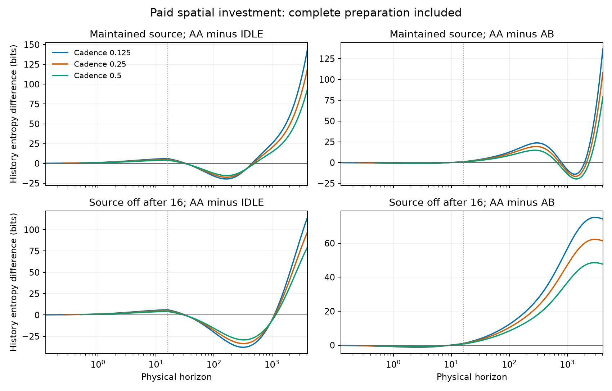

# Version C spatial investment: completed results

The fixed batch completed all18 scientific profiles plus the scoring qualification.
AA-directed investment has greater complete sampled-history lushness than idle
and competing AB construction atT4096 in both source settings at every tested
cadence. Several comparisons reverse within the observation window. The result
supports a finite enacted-investment comparison, not universal organizational
dominance or a permanent rate advantage.

## Numerical outcome

Differences below are AA minus the named alternative, in bits, at cadence0.25.
Every displayed sign agrees at cadences0.125 and0.5. The full profiles disagree
on the precise crossing times, so this is not all-horizon temporal invariance.

| Source | Alternative | T16 | T64 | T256 | T1024 | T4096 |
|---|---|---:|---:|---:|---:|---:|
| Maintained | Idle | +5.062 | -8.396 | -13.957 | +20.635 | +119.677 |
| Maintained | AB | +0.837 | +7.076 | +19.069 | -11.651 | +108.289 |
| Off after16 | Idle | +5.062 | -9.823 | -32.667 | -4.786 | +97.394 |
| Off after16 | AB | +0.837 | +7.124 | +20.165 | +47.703 | +61.348 |

AtT4096, the ranges over the three cadences are:

| Source | Alternative | AA advantage, bits |
|---|---|---:|
| Maintained | Idle | +94.053 to +144.385 |
| Maintained | AB | +78.795 to +136.572 |
| Off after16 | Idle | +79.655 to +114.457 |
| Off after16 | AB | +47.681 to +74.198 |

C1, AA versus idle, is initially positive, becomes negative aroundT30-33, then
positive again. The later crossing is bracketed aroundT450-501 with maintained
supply andT1094-1158 after shutoff. These are observed crossings, not asymptotic
repayment certificates. All full prefixes, including the preparation, are retained.

C2, AA versus AB, begins negative and turns positive aroundT9.5-10. Under maintained
supply it becomes negative again aroundT664-796 and returns positive around
T1982-2388. Under source shutoff it remains positive after the early crossing
throughT4096. Exact cadence-specific brackets are retained in COMPARISONS.json.

C3 therefore demonstrates context dependence, not a universal rule that longer
supply improves the organizational comparison at every horizon. AtT1024, maintained
supply gives AA a lead over idle while shutoff does not; against AB, the direction
is the opposite. Two source prescriptions do not locate a general opportunity frontier.

## Physical interpretation

The modeled enabling chain operates: AA assists BB construction, and BB enables
resource capture. The investment is enacted from the common modeled root, pays
real bank charges, and retains refunds, motion and all preparation histories.
An activity-rich early preparation can itself raise the score; an upfront positive
score is not evidence that the later enabling chain has already repaid its cost.

With maintained supply, AA investment retains and uses more of the enabling
machinery byT4096. Against idle, its cumulative assisted construction is33.103
versus25.078; forward enabled captures38.008 versus29.911, with reverse captures
37.198 versus29.305. Integrated BB occupancy is1892.514 versus1484.062. Endpoint
BB occupancy is0.467305 versus0.369278. This is repeated reversible use, not a
genealogical witness or irreversible-maintenance demonstration.

Actual work and activity differ. In that maintained AA-versus-idle contrast,
net external work is61.375 versus59.658 and expected event count1031.551 versus
1008.943. Against AB, AA has more events but slightly less net external work
(61.375 versus61.751). These comparisons are not jointly work/activity matched.
They do not isolate an organization-only component of the score.

The short-source comparison is especially important. AtT4096, AA leads idle on
lushness although integrated BB occupancy is lower (642.883 versus685.288),
cumulative assisted construction is lower (18.438 versus20.256), and endpoint BB
occupancy is slightly lower (0.133145 versus0.135420). AA has more cumulative
physical events (1032.966 versus1016.900). Thus a final positive breadth difference
does not by itself establish more persistent productive function. No coordinate
entropy decomposition or matched-activity contrast was executed here, so the
score cannot be causally assigned entirely to the enabling pathway or to motion.

Source shutoff removes the maintained work channel, not the thermal bath. Native
thermal pathways, reversible capture, stored energy and reconstruction remain.
The continued short-source gain is not evidence of costless indefinite production
or persistence without all physical opportunity.

## What is established and what remains open

Established in this finite specified model:

- Costed spatial construction, further assisted construction and resource use
  are represented within one shared native grammar.
- Enacted AA investment produces numerically resolved finite-history advantages
  over both declared alternatives, including atT4096 across all tested cadences.
- The profile depends on the alternative, horizon and source prescription, and
  contains losses and reversals as well as gains.

The common ending law within each source setting is finite and irreducible.
Consequently eventual entropy rates agree after the finite pulse. No numerical
limiting offset, permanent rate difference or eventual dominance is established
byT4096. Continued-looking slopes are transient observations.

Not established: activity-independent advantage; dilute-gas superiority; robust
three-generation compounding; independent irreversible maintenance; complete
exterior-command closure; or the sufficiency of lushness for ethical judgments.
These remain scope limits and research directions, not extra publication gates.

## Evidence quality and audit

Numerical confidence: complete finite-state float64 evaluation, independently
checked phase endpoints, paired input contracts and physical balances. Not a
rigorous rounding certificate.

Resolution coverage: full modeled state and three temporal cadences; headline
sign agreement, cadence-dependent crossing times. Physical faithfulness remains
open; no claim that a finer faithful state representation was exhausted.

Physical adequacy: explicit site occupancy, motion, bond construction, rapid-mixed
chemistry, actuator execution and reversible accounting. Reservoir and command
histories remain outside the model. No independent wear drain.

Claim relevance: direct finite investment/alternative/opportunity demonstrations;
limited causal attribution beyond physical activity; no ethical proof.

All19 capped jobs passed, taking3.412 summed job-hours and peaking at3.485GiB.
Maximum endpoint discrepancy4.89e-14; probability normalization drift3.06e-11;
conservative full-schedule first-law residual bound1.96e-13; reconstructed total
chemical-charge residual1.38e-13. All47 frozen inputs match the executed archive;
38 paired contract checks and66 source-off reference audits pass.

The original final EVIDENCE.json used a different manifest schema. Its hashes
were verified, its bytes preserved as EVIDENCE_EXECUTED.json, and the manifest
normalized for the repository checker. No scientific data or executed source
was changed. Post-run analysis is reproducible with scripts/analyze_v42c_results.py.

See [validation](results-2026-11-01/VALIDATION.json),
[comparisons](results-2026-11-01/COMPARISONS.json),
[physical differences](results-2026-11-01/PHYSICAL_DELTAS.json), and the retained
per-job profiles, accounts, contracts, receipts and executed-source snapshot.

Post-run software repair: the executor final manifest formatter now uses the
repository schema for future executions. The actual executed source remains in
SNAPSHOT.zip; none of the batch was rerun after this formatting-only change.
